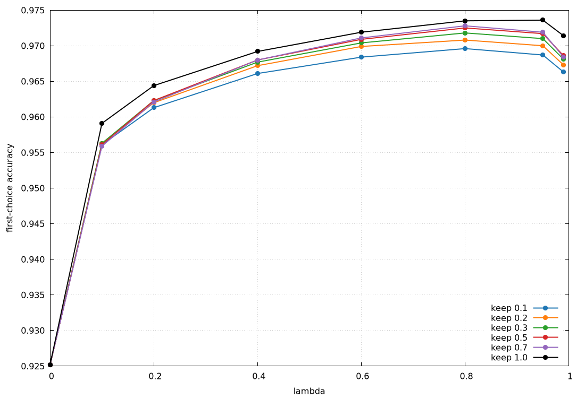

# Chewing Chinese Bigram Language Model

A compact bigram language model for Zhuyin (Bopomofo) IME decoding, trained on [CC-100][1]
~16 GiB of web-crawled Chinese text and validated on a 711,645-sentence held-out set.

[CC-100]: https://data.statmt.org/cc-100/

## Model

- **Type**: unigram + bigram
- **Pruning**: bigrams ranked by KLD, keeping the most discriminative entries

## Evaluation criteria

All variants use the same unigram table; accuracy is first-choice sentence
accuracy on the held-out set at the optimal λ.

| keep_frac | Size   | Accuracy | λ |
|:---------:|:------:|:--------:|:-:|
| 0.1       | 4.9 MB | 96.96% | 0.8 |
| 0.2       | 8.2 MB | 97.08% | 0.8 |
| 0.3       |  12 MB | 97.18% | 0.8 |
| 0.5       |  17 MB | 97.25% | 0.8 |
| 0.7       |  22 MB | 97.28% | 0.8 |
| 1.0       |  28 MB | 97.35% | 0.8 |

Unigram-only baseline (λ = 0): **92.52%** for all variants.

Detail table is in [tuning.dat](tuning.dat).

## Training & validation methodology

- One document per line; train/held-out split by random document-level sampling
  with a fixed seed.
- Held-out evaluation simulates IME input: reference sentences are converted to
  bopomofo sequences and decoded through the same lattice used in libchewing.

## License

This work is licensed under CC BY 4.0. To view a copy of this license,
visit <https://creativecommons.org/licenses/by/4.0/>
